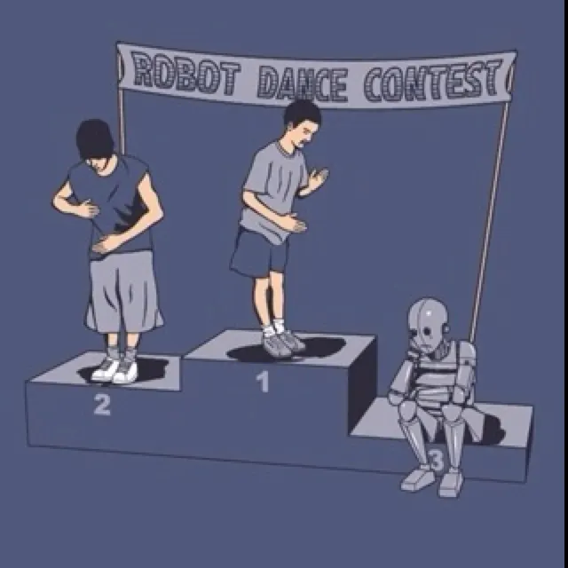
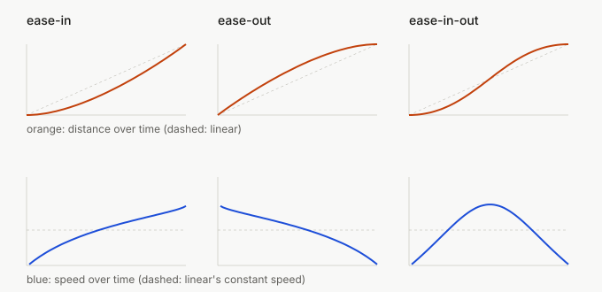
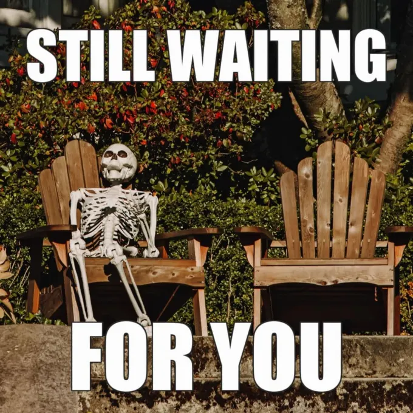
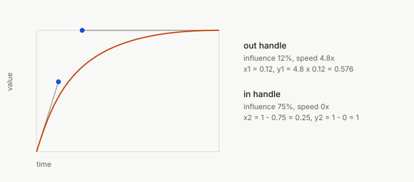

A box can move from left to right in one second in a thousand different ways, and all of them end in the same place at the same time. The only difference is how fast the box goes at each moment in between. That difference is called easing, and it's why one animation feels sharp and another feels like a PowerPoint transition from 2004.

I build [vawe](https://github.com/vawe-hq/vawe), a tool that turns an HTML page into an mp4, so motion is the product. I wanted to know what working animators actually do, not what a blog post says they do. So I pulled 1,339 keyframe segments out of real Lottie files and counted. Some of my rules didn't survive.

This post starts from zero and ends with that data and a cheat sheet. If you already know what `cubic-bezier(0.4, 0, 0.2, 1)` means, skip to [what real animations use](#what-1339-real-segments-use).

## An animation is a value over time

Take a box with `x = 0` at time 0 and `x = 300` at 1 second. An animation is a function that answers one question: at time `t`, where is `x`?

The easy answer is a straight line between the two points.

```js
function x(t) {            // t goes from 0 to 1
  return 0 + (300 - 0) * t;
}
```

At `t = 0.5` the box is at 150. At `t = 0.1` it is at 30. That is linear interpolation (people say "lerp"), and it is what you get if you tell a browser nothing else.

Almost every animation system splits the job in two. One part says "go from A to B over this long". The other is the easing function: it takes the progress through time (0 to 1) and returns the progress through the distance (also 0 to 1, mostly). The box position is then `from + (to - from) * ease(t)`.

```js
const ease = (t) => t;     // this is "linear"
const x = (t) => 0 + 300 * ease(t);
```

Everything below is a different choice for that one small function.

## Why linear looks robotic

Linear sounds like the honest choice, and it looks wrong.

Look at the speed. With `ease(t) = t`, the box moves 30 px every tenth of a second. It's at full speed on the first frame and still at full speed on the last, then it hits a wall: 300 px a second to zero in one frame.

Nothing physical does that. A ball you push needs time to speed up, and a car needs distance to stop. We've spent a lifetime watching things with mass, so something that starts and stops instantly reads as a machine. Which, to be fair, it is.



Linear is still right for a loading spinner, a progress bar that really tracks progress, or anything that loops forever. There the constant speed is the point. Everywhere else you want the speed to change.

## Easing is a speed profile

This is what made it click for me: stop reading an easing as a curve of position and read it as a curve of speed, because speed is what your eye sees.

Speed is the slope of the position curve. Steep means fast, flat means slow. The three classic eases are three speed stories:

- ease-in: start slow, end fast. The box accelerates.
- ease-out: start fast, end slow. The box brakes.
- ease-in-out: slow, fast, slow.



I didn't want to trust the usual descriptions, so I solved the CSS keyword curves and measured them. Here is the program, then its real output. Progress is the share of the distance covered. "Peak speed" is the fastest moment, as a multiple of the average speed.

```js
// position of a cubic-bezier at time x: solve for the curve parameter, then read y
function bez(x1, y1, x2, y2) {
  const B = (a, b, t) => 3 * a * (1 - t) ** 2 * t + 3 * b * (1 - t) * t * t + t ** 3;
  return (x) => {
    let lo = 0, hi = 1;
    for (let i = 0; i < 60; i++) { const m = (lo + hi) / 2; B(x1, x2, m) < x ? (lo = m) : (hi = m); }
    return B(y1, y2, (lo + hi) / 2);
  };
}
```

```text
curve              at 10% at 50% at 90% peak speed (x average)
linear              10.0%  50.0%  90.0% 1.00
ease                 9.5%  80.2%  99.4% 2.29
ease-in              1.7%  31.5%  83.9% 1.72
ease-out            16.1%  68.5%  98.3% 1.72
ease-in-out          2.0%  50.0%  98.0% 1.72
material standard    2.6%  77.6%  99.4% 2.73
```

Take the `ease-out` row. After a tenth of the time the box has covered 16% of the distance, and after half the time it's 68.5% there. The whole second half of the time only buys the last 31.5%. That's "fast start, soft landing" in numbers.

Now `ease`, the CSS default. It reaches 80% of the distance by the halfway point, so it's an ease-out in disguise. That surprised me. The default isn't neutral; someone chose it for you.

## Which one to use: ease-in, ease-out or ease-in-out?

People search for this one a lot, and the short answer comes from asking what the thing is doing on screen.

Arriving, appearing, opening: ease-out. The thing comes from outside and the user is waiting for it. A fast start means it reacts at once, and a slow end lets it land gently. Think of a menu that opens or a card that slides in.

Leaving, closing, dismissing: ease-in, or at least not a slow start. The user has already decided, and a long slow start only makes them wait.

Moving from one resting place to another: ease-in-out. The thing is already visible and goes somewhere else, so it should leave smoothly and arrive smoothly.

That's the textbook answer, and I built vawe on it. Then I checked it against data and the "leaving" half didn't hold (more below).

A trap on ease-in: it feels slow even at the same duration, because the first part of the time barely moves anything. See the `ease-in` row again: 1.7% of the distance after 10% of the time. On something the user triggers, a pure ease-in can feel laggy, so keep it short.



## cubic-bezier and its four numbers

The CSS keywords aren't special. Each one is shorthand for a `cubic-bezier()`, per [MDN](https://developer.mozilla.org/en-US/docs/Web/CSS/easing-function):

| keyword | cubic-bezier |
| --- | --- |
| `ease` | `0.25, 0.1, 0.25, 1` |
| `ease-in` | `0.42, 0, 1, 1` |
| `ease-out` | `0, 0, 0.58, 1` |
| `ease-in-out` | `0.42, 0, 0.58, 1` |
| `linear` | `0, 0, 1, 1` |

The four numbers are the coordinates of two points, `(x1, y1)` and `(x2, y2)`. The curve starts at `(0, 0)` and ends at `(1, 1)`. The two extra points are handles: they pull the curve toward them like magnets, and the curve never touches them.

You can read them without a tool:

- `(x1, y1)` is the handle at the start. The line from `(0, 0)` to it sets the starting speed. Steep is a fast start; flat (`y1 = 0`) is a start from rest.
- `(x2, y2)` is the handle at the end. The line from it to `(1, 1)` sets the end speed. Flat (`y2 = 1`) is a soft landing.
- The x of a handle says how long its influence lasts.

Check it on `ease-out`, `0, 0, 0.58, 1`. The first handle sits at the origin, so the start is a plain straight push. The second has `y2 = 1`, so the end is flat. Fast start, soft end.

The spec says x must stay between 0 and 1, but y can be any number. That's where overshoot comes from: `cubic-bezier(0.34, 1.56, 0.64, 1)` has `y1 = 1.56`, so the curve rises past 1 and comes back. Time can't go backwards, so x is limited. Position can, so y isn't.

Two other CSS functions sit next to `cubic-bezier`. `steps(4)` jumps in four equal steps with no smooth part, which suits sprite sheets and typewriter effects. `linear()` takes a list of points and draws straight lines between them. With enough points it can draw any curve, including a spring, which a bezier can't.

```css
.box { transition: transform 600ms linear(0, 0.4 18%, 0.8 40%, 1.06 60%, 0.98 80%, 1); }
```

## Springs: when a curve is the wrong model

A bezier has a fixed duration: you say 400 ms and it takes 400 ms. A spring has none. You give it a stiffness, a damping and a mass, and it settles when the physics says so.

```js
// damped spring, position over time, from 0 toward 1
function spring(t, k = 120, d = 14) {      // k stiffness, d damping, mass 1
  const w = Math.sqrt(k), z = d / (2 * w);
  if (z >= 1) return 1 - (1 + w * t) * Math.exp(-w * t);        // no overshoot
  const wd = w * Math.sqrt(1 - z * z);
  return 1 - Math.exp(-z * w * t) * (Math.cos(wd * t) + (z * w / wd) * Math.sin(wd * t));
}
```

Springs are popular in interfaces for two reasons. Overshoot comes built in: a lightly damped spring passes the target and comes back, and the damping decides by how much, so you don't hand-pick `y1 = 1.56`. And a spring can be interrupted. If the user drags a card halfway through, the spring keeps its current velocity and carries on toward the new target. A bezier restarts from zero speed, and you feel the jolt.

The cost is that you can't say "this takes 300 ms" without computing the settle time. For a gesture, a drag or a toggle, a spring wins. For a fade or a page transition with a fixed length, a bezier is simpler and more predictable. I use both. In vawe a short list of named curves handles most moves, and a spring handles small arrivals like a chat bubble.

## After Effects: influence and speed

Open the graph editor in After Effects and you get two controls instead of four numbers: influence and speed. They describe the same thing as `cubic-bezier`, and once you see the translation, the motion designer's vocabulary and CSS's are one language.

Every keyframe has two handles, one for the segment leaving it and one for the segment arriving. Each handle has:

- influence: how far along the segment the handle reaches, as a percentage of the duration. That's the x of the control point.
- speed: how fast the value moves at the keyframe, as a multiple of the segment's average speed. 0 is a dead stop, 1 is a straight line, 4 rushes out.

Translating to bezier takes two lines. For the out handle, `x1 = influence / 100` and `y1 = speed * x1`. For the in handle, `x2 = 1 - influence / 100` and `y2 = 1 - speed * influence / 100`. This is how vawe converts them, in <a class="src-link" href="https://github.com/vawe-hq/vawe/blob/b7a8eeb399e6ca592658488ec2f0cd27299d830d/scripts/site/easing.mjs" target="_blank" rel="noopener noreferrer">↗ scripts/site/easing.mjs · entry.bezier</a>



The picture shows an out handle of 12% influence at 4.8x speed and an in handle of 75% at 0x. That gives `cubic-bezier(0.12, 0.576, 0.25, 1)`: it explodes off the start and glides to a long stop.

Two AE defaults show up everywhere in real files. A new keyframe is linear, with influence 16.7% and speed 1x (that is what the data below shows; I couldn't find it in Adobe's docs). Press F9 for Easy Ease and both handles become influence 33.3%, speed 0, which gives the soft S-curve. Keep these two pairs in mind for the next part.

## What 1,339 real segments use

Every guide says what pros do. I wanted to look. I took Lottie animation files from the open-source Lottie projects (lottie-android, lottie-ios, lottie-web, Apache-2.0 and MIT), pulled out every keyframe segment, and recorded the two handles of each (influence and speed), plus whether the segment is an entrance, exit or something else. The result is a 1,339-row table, committed in the repo as <a class="src-link" href="https://github.com/vawe-hq/vawe/blob/b7a8eeb399e6ca592658488ec2f0cd27299d830d/scripts/site/data/ae-handles.json" target="_blank" rel="noopener noreferrer">↗ scripts/site/data/ae-handles.json</a>

The table's own source note points to a report that no longer exists, so here is the method as the parsing script ran it. I downloaded 94 Lottie files from those three repos. 55 of them had moving segments I could use, and those 55 gave the 1,339 rows. One spec test file with 3,149 segments was dropped, and every other file is capped at 60 segments so no single file dominates. Static, held and under-two-frame segments are skipped.

The label comes from the script, not from my eye. For each animated property it takes the keyframe where the value rests longest as the "rest" value. A segment that moves toward the rest value is an entrance. One that moves away from it and ends within half a second of the layer's end is an exit. If the next segment also moves, the segment is a glide, whatever its direction. Anything left over is a rarer label (`depart`, `carry`, `move`), which is why the table has more than three roles. The file is a heuristic, and the 57 exits are its weakest group. The script itself is gone, so you cannot rerun this from the repo.

Here is a small script that reads the table. Run it yourself.

```js
const near = (i, s, I, S) => Math.abs(i - I) < 1.5 && Math.abs(s - S) < 0.06;
const lin  = (i, s) => near(i, s, 16.7, 1);     // AE's default keyframe
const easy = (i, s) => near(i, s, 33.3, 0);     // Easy Ease (F9)
```

```text
segments 1339
both handles linear (16.7%, 1x): 490 (36.6%)
both handles Easy Ease (33.3%, 0x): 253 (18.9%)
only default handles, any mix: 874 (65.3%)
roles { entrance: 616, glide: 610, exit: 57, carry: 7, depart: 49 }
exits 57 | arrive at >=1.5x average speed: 0 | arrive at <=0.1x (a near stop): 34
entrances 616 | arrive at <=0.1x with influence >=55%: 158
top handle pairs: 16.7/1 -> 16.7/1 (490), 33.3/0 -> 33.3/0 (250), 16.7/1 -> 33.3/0 (93), 60/0 -> 60/0 (40)
```

(The site's own build script uses a slightly stricter match and reports 871 of 1,339, 65.05%. Same story.)

Three things came out of this.

Most real animation uses the defaults. About 65% of segments use only AE's two stock handle shapes: 37% are plain linear in the handle sense and 19% are plain Easy Ease. Only 468 of the 1,339 had any hand-tuned handle. The custom curve for every move that I'd imagined is the minority. That matches what animators tell you: most of it is Easy Ease and a good duration.

Long, soft arrivals are common. 158 of 616 entrances (25.7%) arrive at nearly zero speed with an in-influence of 55% or more. That's the "glide into place" shape, where the end of the segment spends over half its length braking. The 60/0 pair (influence 60%, speed 0) shows up 40 times on its own.

Real exits don't accelerate, and here the textbook broke. The rule I'd written, and many articles repeat, says an exit should speed up and leave. Of the 57 exits, none arrive at 1.5x the average speed or more, and 34 end at nearly zero speed. They brake. An exit in the wild is mostly an ease-out or an ease-in-out that happens to run in reverse.


57 is a small sample, it comes from Lottie files rather than product films, and "exit" is a label I assigned. So this doesn't prove accelerating exits are wrong. It shows that "pros accelerate exits" had no support in this data, and I'd been treating it as fact.

## Rules that the data broke

Some defaults in vawe came from articles. The table disagreed with two of them, and I changed the numbers in the commit <a class="src-link" href="https://github.com/vawe-hq/vawe/commit/63f630419e87801d5eeb73f888960161247a83b4" target="_blank" rel="noopener noreferrer">↗ 63f6304 · motion: After Effects handles as the default easing</a>

- `fling`, the fast-out handle: I had influence 18% at 4x. The data (HyperFrames carousels, 27 segments, median 12.5% out) said 12% at 4.8x. The real handle is shorter and sharper.
- `overshoot`, the handle that makes a value pass its mark: I had influence 62% at speed -0.8. The Lottie medians were 35% at -0.4. The old values passed the target by about 10%, which looks like a cartoon. The real ones pass by about 1%.

Both changes were tiny, and both moved how every entrance in the tool feels. I'd never have caught them by watching the animations, because each looked fine alone. They only looked wrong next to real files.

One more surprise: my own `land` curve, the fling-then-hang pair I use for entrances, matches only 2 of the 1,339 real pairs. Real animation clusters on the stock shapes, and my favourite curve is rare. I'm keeping it, since it came from carousels where a fast start matters, but it's a taste decision, not a norm.


## How to pick, with durations

The curve is half the answer. The other half is how long. These are my own working ranges, not a standard and not from a source:

- Small feedback (a button, a toggle, a hover): 100–200 ms.
- A menu, a card, a modal opening: 200–400 ms.
- A large or full-screen move: 400–600 ms.
- Anything beyond 700 ms needs a reason, like a hero moment or a film.

Go longer for bigger distances and shorter for exits. Whatever the duration, test it at 1x speed on a real device, because slow-motion playback lies about how a transition feels.

If you remember one curve, make it the Material Design curve `cubic-bezier(0.4, 0, 0.2, 1)`, called "standard" in Material 2 (Flutter ships it as `Curves.fastOutSlowIn`, described as the standard curve for elements that begin and end at rest). It's an ease-in-out that leans toward ease-out: gentle start, fast middle, long soft end. In my table above it reaches 77.6% of the distance by half time. It's a good default for things moving between two places.

Material 3 changed the names. Its easing tokens in the open-source material-web repo ([`_md-sys-motion.scss`](https://github.com/material-components/material-web/blob/60c0cfa58ad135c189cb0fa95c5f2744499f0327/tokens/versions/v0_192/_md-sys-motion.scss)) list the old curve above as `easing-legacy`, and "standard" now means a different, sharper curve:

| Token | `cubic-bezier` |
| --- | --- |
| `easing-standard` | `0.2, 0, 0, 1` |
| `easing-standard-accelerate` | `0.3, 0, 1, 1` |
| `easing-standard-decelerate` | `0, 0, 0, 1` |
| `easing-emphasized` | `0.2, 0, 0, 1` |
| `easing-emphasized-accelerate` | `0.3, 0, 0.8, 0.15` |
| `easing-emphasized-decelerate` | `0.05, 0.7, 0.1, 1` |
| `easing-legacy` | `0.4, 0, 0.2, 1` |
| `easing-legacy-accelerate` | `0.4, 0, 1, 1` |
| `easing-legacy-decelerate` | `0, 0, 0.2, 1` |

In that file `easing-standard` and `easing-emphasized` have the same numbers.

## Cheat sheet

Save this part.

| Situation | Easing | `cubic-bezier` | Duration |
| --- | --- | --- | --- |
| Spinner, progress bar, endless loop | `linear` | `0, 0, 1, 1` | any |
| Element appears or opens | ease-out | `0, 0, 0.58, 1` | 200–400 ms |
| Element moves between two places | ease-in-out | `0.42, 0, 0.58, 1` | 300–500 ms |
| Default for UI moves | Material (M2 standard, M3 `legacy`) | `0.4, 0, 0.2, 1` | 200–400 ms |
| Element leaves | ease-out or ease-in-out (data), short | `0, 0, 0.58, 1` | 150–250 ms |
| Long, soft landing | AE 60% influence, 0 speed | `0.6, 0, 0.4, 1` | 500 ms+ |
| Fast start, long landing | AE `fling` + `hang` | `0.12, 0.576, 0.25, 1` | 400–800 ms |
| Overshoot, small and playful | back-style | `0.34, 1.56, 0.64, 1` | 300–500 ms |
| Drag, gesture, anything interruptible | spring | k 120, d 14 | settles itself |
| Sprites, typewriter | `steps(n)` | none | n frames |

Translating from After Effects:

```text
x1 = outInfluence / 100          y1 = outSpeed * x1
x2 = 1 - inInfluence / 100       y2 = 1 - inSpeed * inInfluence / 100
Easy Ease (33.3, 0) both sides   -> cubic-bezier(0.333, 0, 0.667, 1)
```

And the habits worth keeping:

- Don't ship the browser default (`ease`) without choosing it. It's an ease-out with a gentle start.
- Pick one or two curves per interface. Consistency beats cleverness.
- Overshoot says "this has weight". Keep it off text and numbers.
- Check your own rules against real files. Mine failed twice.
