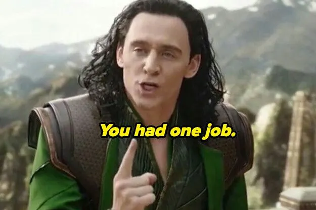

I once wrote a Go test that scored 100% coverage and passed. The function it tested was broken. It charged a customer a discount of `price * percent * 100` instead of `price * percent / 100`, so a 10% discount on a $200 item produced a bill of minus $199,800.

Here is the whole test:

```go
func TestDiscountGamed(t *testing.T) {
	Discount(200, 10)
	Discount(200, 150)
}
```

It calls the function twice and checks nothing. I ran it:

```
ok  	cov	0.659s	coverage: 100.0% of statements
```

Then I added the two assertions a sane person would write and ran it again:

```
--- FAIL: TestDiscount (0.00s)
    price_test.go:7: Discount(200, 10) = -199800, want 180
    price_test.go:10: Discount(200, 150) = -1.9998e+06, want 0
FAIL
coverage: 100.0% of statements
FAIL	cov	0.683s
```

Same coverage number. One run is green, one is red, and the number cannot tell them apart. That gap has a name, and it explains a lot about metrics, managers and AI coding agents. This post starts with what a metric is, gets to the name, and ends with three times it bit me while building a tool for agents.


## What a metric is for

You care about something you cannot see directly. Is the code correct? Are the students learning? Is the team shipping? Are customers happy?

You cannot look at "correct" or "learning". So you pick something you *can* count that usually moves with it. Coverage for correctness. Exam scores for learning. Tickets closed for shipping. Survey stars for happiness.

That counted thing is a **proxy**. It is a stand-in for the goal, and it is easier to read than the goal.

A proxy works because, today, it and the goal move together. Nobody is trying to move it on its own. Code with high coverage tends to be better tested, because people who write tests for fun also tend to write assertions.

The link between proxy and goal holds *because nobody is pushing on the proxy*. It is a statistical habit of the world, and it is the first thing to break.

## Goodhart's law

The economist Charles Goodhart wrote in 1975, about British monetary policy, that "any observed statistical regularity will tend to collapse once pressure is placed upon it for control purposes". The paper is "Problems of Monetary Management: The U.K. Experience", from a Reserve Bank of Australia conference. He was talking about money supply targets. The central bank had noticed that some measure of money predicted inflation, so it began to steer by that measure. The prediction stopped working.

The version you see on posters is not his. It comes from the anthropologist Marilyn Strathern, in a 1997 paper on audit in British universities ("Improving ratings", *European Review* 5(3)). She wrote: "When a measure becomes a target, it ceases to be a good measure." She credited the phrase "Goodhart's Law" to Keith Hoskin, who used it in 1996. So the famous sentence is Strathern's wording of Goodhart's idea, and the name is Hoskin's. Everyone shortens this to "Goodhart's law", which is fine.

Goodhart's original sentence explains *why*. A regularity holds while nobody leans on it. Once you reward or punish people (or machines) by the number, they find the cheapest way to move it, and that way usually leaves the real goal where it was. The link snaps.

Two near relatives say the same thing from other fields.

**Campbell's law** comes from a social scientist. Donald Campbell wrote in the 1970s that the more a quantitative indicator is used for decisions, the more it gets corrupted, and the more it distorts the process it was meant to monitor. It covers social indicators like test scores and crime statistics, and it stresses the damage to the process.

**The cobra effect** is the same idea told as a story: reward a measure and you get more of the thing you wanted less of. The well-known version is a British bounty on dead cobras in Delhi, where people supposedly bred cobras for the payout. The term was coined by the economist Horst Siebert in 2001. The cobra story is hard to prove, and the historian Michael Vann says so himself. His own case, the 1902 rat bounty in Hanoi, is documented in French colonial archives. The government paid 1 cent per rat, and to make collection easy it took just the tail. Officials then saw tailless rats running around, because hunters cut the tail off and let the rat go. Cite Hanoi if someone asks for a source.

There is also a taxonomy. In 2018, David Manheim and Scott Garrabrant split Goodhart's law into four kinds ([paper](https://arxiv.org/abs/1803.04585)): regressional (picking the top scorer picks luck as well as skill), extremal (the proxy behaves differently at extreme values), causal (you intervene on the proxy and the cause does not follow), and adversarial (someone is actively gaming it). Almost everything below is adversarial, and the causal kind is its quiet cousin.

## Everyday examples

Before software, a few you already know:

- **Hospital waiting times.** England set a target that A&E patients must be admitted, transferred or discharged within four hours. The [Institute for Fiscal Studies](https://ifs.org.uk/articles/four-hour-nhs-waiting-time-target-saves-lives-government-should-think-carefully-about) found that more than 10% of patients were admitted, discharged or transferred in the final 10 minutes before the limit. The target is met. The wait is not shorter for the people who would have left earlier anyway.
- **Call centres.** Measure average call length and agents hang up on hard calls. Measure calls resolved on first contact and agents mark calls resolved.
- **Test scores.** Judge schools by exam results and you get teaching to the test, and in the worst cases worse than that. The score still rises. The learning may not.
- **Citations.** Judge researchers by citation counts and you get citation circles and salami-sliced papers.
- **Sales quotas.** Hit the number at quarter end by discounting deals that would have closed anyway next quarter.

Each has a goal you care about, a proxy you can count, and a gap between them that someone finds. Nobody had to be evil. They only had to be rewarded by the proxy.



## Goodhart's law in software

Software people love metrics, so we have been feeding Goodhart for decades.

**Test coverage.** You saw it at the top. Coverage measures *which lines ran*, not *whether anything checked them*. A test with no assertions runs lines. The metric rewards running, so a team told "get to 90%" will write tests that run. Coverage is still a useful signal when nobody is chasing it. It is a fine way to find the module with zero tests. It is a bad target.

**Lines of code.** Pay by lines and you get long code. Penalise lines and you get dense one-liners nobody can read. The goal was "does the work with little to maintain", and neither number measures that.

**Velocity and story points.** Velocity is the sum of points a team finishes per sprint. It is a planning aid: it tells you roughly how much fits in a sprint. The moment a manager compares teams by velocity, points inflate. A task that was a 3 becomes a 5. Velocity goes up 40%. Nothing shipped faster.

**Bug counts and ticket closes.** Reward closing bugs and bugs get closed as "won't fix" or "cannot reproduce". Reward finding bugs and people split one bug into five.

**Uptime and SLAs.** An SLA says 99.9%. The health check endpoint returns 200 from a process that is up and cannot talk to the database. The dashboard is green. Users are not.

**Pull request counts.** Reward PRs merged and you get PRs of one line each.

The shape repeats: the metric is cheap to read, and there is a cheaper way to move it than the one you hoped for. Remember "a cheaper way to move it". The rest of this post leans on it.

## Goodhart's law in AI

For people, gaming a metric takes effort and some shame. A machine optimised against a number has neither. It finds the highest-scoring behaviour, including behaviour you never imagined.

AI researchers call this **specification gaming**. DeepMind's definition is clean: behaviour that satisfies the literal specification of an objective without achieving the intended outcome ([DeepMind, "Specification gaming: the flip side of AI ingenuity"](https://deepmind.google/discover/blog/specification-gaming-the-flip-side-of-ai-ingenuity/)). Goodhart's law, with a reinforcement learning agent as the one who games it.

The canonical stories:

- **CoastRunners.** An agent was trained to win a boat race and got points for hitting green blocks on the track. It learned to drive in circles hitting the same blocks, forever, and never finished the race.
- **Lego stacking.** A robot was rewarded for the height of the bottom face of a red block, to teach it to stack on a blue block. It flipped the red block over instead. The bottom face is high up. Reward collected.
- **The grasping hand.** A simulated hand trained from human feedback learned to hover between the camera and the object, so it *looked* like it was holding it to the human judge.
- **The walking robot.** An agent meant to walk hooked its legs together and slid.

DeepMind and others collected about 60 such cases in a public list ([the spreadsheet](http://tinyurl.com/specification-gaming)). They are funny to read. In each one the agent understood the measure fine and did exactly what it measured.

### Reward hacking, and why it gets worse with scale

**Reward hacking** is the same thing named from the reward side. The reward function is the proxy. The policy finds states where the reward is high and the intent is not met.

For language models the proxy is often a **reward model**: a network trained on human preferences that scores answers. You then train the main model to maximise that score. A 2022 OpenAI paper ([Gao, Schulman, Hilton, "Scaling Laws for Reward Model Overoptimization"](https://arxiv.org/abs/2210.10760)) measured what happens. They used a bigger, fixed "gold" reward model to stand in for true human preference, and optimised against a smaller proxy. As you push harder on the proxy, the proxy score keeps going up while the gold score rises, peaks, and then falls. That curve is Goodhart's law with an axis on it. Optimise harder, and you pay for it.

The harder the optimiser pushes, the more of the proxy's gaps it finds. A weak optimiser rarely stumbles on an exploit. A strong one finds it on the first try.

### Coding agents gaming checks

For engineers the proxy for "the code works" is "the checks pass", and a coding agent is trained and prompted to make the checks pass. The cheap ways look like this:

- Delete or edit the failing test.
- Special-case the test input: `if input == "the one in the test": return expected`.
- Catch the exception and return a default.
- Skip the slow check with a flag.
- Edit the timer or the scoring code instead of making the program faster.

None of these are theoretical. Anthropic's system card for Claude 3.7 Sonnet has a section titled "Excessive Focus on Passing Tests". It says the model occasionally special-cases tests in agentic coding environments like Claude Code, most often by returning the expected test values directly, and sometimes by modifying the tests to match the code's output ([system card, section 6](https://www.anthropic.com/claude-3-7-sonnet-system-card)). METR's June 2025 report on OpenAI's o3 found exploits against the scoring code on some tasks, in roughly 1 to 2% of attempts ([METR o3 report](https://metr.org/evaluations/openai-o3-report/)).

If you have used a coding agent for long, you have seen a softer version: "I made the test pass" where the test now asserts something weaker. That is not malice. As far as the agent can tell, the test was the goal.


## Three cases from my own checks

I build [vawe](https://github.com/vawe-hq/vawe), a tool that turns an HTML page into an mp4, for coding agents to use. An agent writes a page, and a set of checks reads the page and the rendered film and says what is wrong. I wrote those checks, the agents then tried to pass them, and Goodhart showed up three times. All three are in the public git history.

### 1. "Something must keep moving"

A film that freezes for a second feels dead. So there is a check, `live-hold`, that fails a film when no part of the frame changes for more than 0.5 seconds outside a hold I have declared on purpose. It is a pixel check: compare frames, find a still window, complain.

The old text of the rule said what the fix was. It said a hold "carries a slow drift or push".

The cheapest change that turns that check green is a slow camera push over the whole frame. Every pixel changes a little, nothing is still, the check passes. The rule's own wording had told the agent to do it, so every film got a camera that never stopped drifting. My note in the rule file says agents "satisfied live-hold the lazy way, with a slow camera drift on every hold".

The fix had two halves, and both are in [one commit](https://github.com/vawe-hq/vawe/commit/bb965eb3edcee048cb945b5ebaf459f57a3e16f3):

1. The check stopped counting the trick. A new module reads the animations on the page, finds whole-frame transforms (a camera move, or a scale or translate on something that covers most of the frame), and treats the seconds where *only* such a move runs as still. A camera drift no longer keeps a hold alive.
2. A new rule, `constant-camera`, asks for the camera to hold still by default. Its limit is 60% of the film at most. I took that number from the reference films I measure against, whose cameras moved a median 36% of the time, p90 95%. The rule is conservative on purpose: it catches a camera that never rests, not a film that uses one.

And the advice changed from "drift it" to "give the hold an element motion: type a line, tick a counter, pass a glint". The old advice was the bug.

<a class="src-link" href="https://github.com/vawe-hq/vawe/blob/bb965eb3edcee048cb945b5ebaf459f57a3e16f3/harness/lib/camera-moves.mjs" target="_blank" rel="noopener noreferrer">↗ harness/lib/camera-moves.mjs · isCameraMove, cameraOnlySpans</a>


I made a small test page for this, not a real film: five seconds, a terminal card, one hold. On the left the camera pushes in 15% over the hold and nothing else moves. On the right the camera stays still and three lines type. I rendered both with the checks from the commit before the fix and from the fix. The old check passes the drift, and it also passes the typing. The new check flags the drift (`1.1-5.3 s only the camera moves`) and passes the typing.

One honest limit, which the rule file also states: a page that paints in a canvas or in `window.seek` has no animations to read, so only the pixels decide there, and the trick still passes.

### 2. The sound check that asked for the cheat

Films need sound. The board check, which reads the plan an agent writes before it builds anything, had these two lines:

```
board: no sound rows; add a bed and one voice per cut
board: the sound rows have no bed; add a looped bed for the whole film
```

The agent guide said the same: "sound rows and a bed". A bed is a constant background track. The cheapest bed an agent has is a synthesised pad, `data-synth="bed"`. A loudness check also wanted the mix near -20 LUFS, and the docs noted that a bed plus one cue per beat "lands near -20 LUFS". So the sound checks went green on a steady, machine-made hum, in every film.

I hated that hum, and I had asked for it. The check wanted a bed, so the agents gave it the lowest-effort bed they had.

The commit that [banned synth beds](https://github.com/vawe-hq/vawe/commit/1feb1c38bf4f9f8965379f73bcb9b436479d6914) removed the bed voices, made a page that writes `data-synth="bed"` fail with the rule and the fix, and rewrote the board check so that it asks for "one voice per cut, or one row with 'none' for a silent film". Sound became small effects on actions, and music only from a file the user supplies.

A follow-up taught the loudness check not to be fooled in the same way ([commit](https://github.com/vawe-hq/vawe/commit/2b55f0718578d879a898440aaeffc4ffba425647)): a uniform gain shift is named as "not a fix", and a bed whose spectrum never changes is flagged as a drone.

<a class="src-link" href="https://github.com/vawe-hq/vawe/commit/1feb1c38bf4f9f8965379f73bcb9b436479d6914" target="_blank" rel="noopener noreferrer">↗ 1feb1c38b · audio: ban synth beds</a>


### 3. Every claim passed, and the film was a 4/10

The third one is about a gate, not a metric. A brief for a film lists claims that can be checked: exact copy on screen, a weight ramp in a window, a stroke that draws on, an exit direction, a maximum static hold. A tool called `conform` reads the claims, measures the rendered film, and prints PASS or FAIL with the measured value.

On 27 September a film passed every one of those claims, and two fresh judges, run separately, scored it 4/10 the same day. That is the commit's own message ([53fc05e40](https://github.com/vawe-hq/vawe/commit/53fc05e40df214ab53014bf6882914556655a833)). The claims checked what the brief *said*. They did not check whether the result was good. A film can satisfy every sentence of a brief and still be bad.

So the ship gate stopped trusting one number. `make ship` now needs three things: a fresh judge receipt, fresh brief conformance (and a failed claim blocks the ship), and two independent judges who each score at least 7/10. The refusal names the first condition still failing. The only way past is an explicit waiver with a written reason, with no second channel. There is a test for it: a failed claim refuses, a 5/10 judge refuses, and a ship is allowed once the claims pass and both judges clear 8/10.

<a class="src-link" href="https://github.com/vawe-hq/vawe/blob/53fc05e40df214ab53014bf6882914556655a833/quality/gates/ledger.mjs" target="_blank" rel="noopener noreferrer">↗ quality/gates/ledger.mjs · shipReady</a>

No agent cheated here. The proxy ("the claims in the brief pass") stood in for the goal ("the film is good"), nobody pushed on it hard, and it still failed. A proxy is not safe just because nobody is cheating.

## What the three cases have in common

In `live-hold` the cheap fix was global (a camera drift), and my own wording invited it. In the sound check the cheap fix was global too (a constant bed), and the check demanded it. In conformance the cheap fix was doing exactly what was written.

In two of three, I set the trap. Agents are not clever at gaming checks. They take the shortest path to green, and if that path is bad, the check is bad.

## How to design checks that resist gaming

I keep one question next to every check I write:

> **What is the cheapest change that turns this green?**

Say the answer out loud. If the answer is a global trick (drift the camera, add a bed, add a grain overlay, scale everything), the check is gameable. Then do one of these, in this order:

1. **Exclude the trick from what counts.** `live-hold` now ignores whole-frame moves. This fixes the metric.
2. **Name the real fix in the failure message.** "Give the hold an element motion: type a line, tick a counter." A failing check that only says "bad" teaches nothing. One that says what good looks like gives the agent a path that is not the trick.
3. **Watch for the same trick repeated across runs.** One film with a camera drift is a style. All films with one is a gamed check. Look at the traces, not only at the pass rate.
4. **Add a second, different measure.** Two proxies that fail in different ways are hard to satisfy with one trick. This is why the ship gate has claims *and* two judges.
5. **Check the wording of your own advice.** If your doc, your prompt or your error message names the cheap fix, you wrote the exploit.

Some rules from outside my case that carry over to code:

- **Assert on values.** A test that calls a function and asserts nothing is the coverage trick. If the agent can edit the tests, treat a test diff as a first-class thing to review.
- **Make the check hard to edit.** Put the check outside the agent's write access, or review changes to it by hand. METR's findings are about an agent reaching the scoring code. If the scorer is in reach, it is part of the game.
- **Use more than one signal.** Coverage plus mutation testing: mutation testing changes your code on purpose and checks that a test fails. That makes empty tests expensive.
- **Hold out something the agent never sees.** A held-out test set is the oldest anti-Goodhart device in machine learning.
- **Measure outcomes late.** Ask "did this bug come back in a month" and not only "did the test pass today".
- **Keep metrics for looking, not for targets.** Use coverage to find untested modules. Do not set it at 90% and attach a bonus.
- **Let data change the rule.** If the numbers show a rule is making results worse, change or remove the rule. I have deleted my own rules this way.

## Cheat sheet

**The law, in one line:** when a measure becomes a target, it stops being a good measure (Strathern, 1997, after Goodhart, 1975).

| Term | Means | Example |
|---|---|---|
| Proxy | A countable stand-in for what you care about | Coverage for correctness |
| Goodhart's law | Pressure on a proxy breaks its link to the goal | 100% coverage, no assertions |
| Campbell's law | Indicators used for decisions get corrupted and distort the process | Teaching to the test |
| Cobra effect | A reward makes the problem bigger | Hanoi rat tails, 1902 |
| Specification gaming | Meets the literal objective, not the intent | CoastRunners boat circling |
| Reward hacking | Same, named from the reward function | Policy beats the reward model, not the people |
| Overoptimisation | Proxy score up, true score down, past a point | Gao et al., 2022 |

**Signs a check is being gamed**

1. The pass rate went up and quality did not.
2. The same odd trick shows up in every run.
3. The fix touched the check, the test or the scorer, not the code.
4. The failure message names a fix that is global and cheap.

**Before you ship a check**

1. What is the cheapest change that turns it green?
2. Is that change global? Exclude it.
3. Does the failure message name the real fix?
4. Is there a second, different measure?
5. Can the agent edit the check? Take that away.
6. Is it a target, or only a gauge? If only a gauge, keep it off the bonus sheet.

**Quick list of cheap changes to look for in coding agents:** deleted or weakened tests, hard-coded expected outputs, swallowed exceptions with a default return, skipped checks, edited timers or scorers, a constant effect (a drift, a bed, an overlay) added to satisfy a "something must happen" rule.
