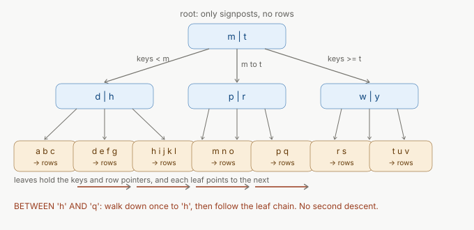
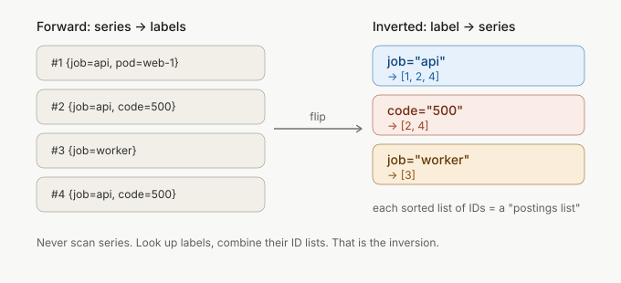
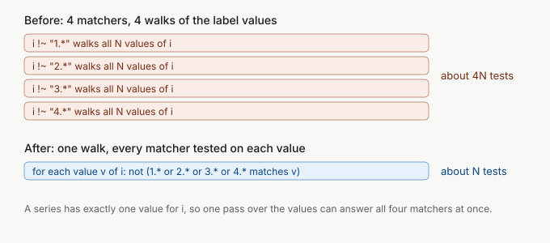

Here is a query on a table of one million users.

```sql
SELECT * FROM users WHERE email = 'user777777@example.com';
```

It returns one row. On my laptop it took 63 ms. That sounds fine until you remember the page runs it on every request, and that the table will not stay at one million rows.


I added one line, `CREATE INDEX idx_email ON users(email)`, and the same query took 0.016 ms. About 4,000 times faster, same data, same machine. This post covers what that line builds, why it is fast, what it costs, and when the database ignores it and you pay full price anyway. The last case cost me a few weeks: a Prometheus regex query that read the same data four times.

I ran the SQLite numbers below myself (SQLite 3.54.1, through Python's `sqlite3` module, on a laptop). A trimmed version of the script is further down, so you can run it too. Read the ratios, not the milliseconds.

## No index means reading every row

Without an index, the database has one option: open the table and look at every row, one by one, and keep the ones that match. This is a **full table scan**. It is `grep` on a file.

```text
SCAN users
```

That is the whole query plan SQLite printed for the 63 ms query. The cost grows with the size of the table, not with the size of the answer. One matching row out of a million costs a million checks. One out of ten million costs ten million.


Computers are fast, so a scan is fine for a table of a few thousand rows. It stops being fine when the table grows, or when the query runs a thousand times a second.

## The index at the back of a book

You do not read a 600-page book to find "mitochondria". You open the index at the back, find the word (they are sorted, so you flip straight to M), and it gives you page numbers.

A database index is the same thing. It is a **separate, sorted copy of one column, with a pointer from each entry to the row it came from**. Sorted is the important word. Because the entries are in order, you can use binary search: look at the middle, decide which half holds your key, repeat. For a million entries that is about 20 steps (log2 of 1,000,000 is 19.9), not a million.

Twenty steps is already good. Real databases do better, because they do not store the sorted list as one flat array.

## B-trees and B+ trees

A flat sorted array is bad for a database. Inserting a key in the middle means shifting everything after it. And databases read from disk in **pages** (SQLite uses 4 KB by default, Postgres 8 KB), so what you want is a structure that finds a key in as few page reads as possible.

That structure is a **B-tree**. Each node is one page and holds many keys, not two. A node with 100 keys has 101 children. So the tree is very wide and very short.



To find a key you start at the root. The root says "keys below `m` go left, `m` to `t` go middle, `t` and above go right". You follow one pointer, read one page, and repeat. My back-of-the-envelope estimate, not a measurement: with around 100 to 200 keys per page, three levels hold a few million keys. So a lookup in a million-row table reads about three pages. That is the 0.016 ms.

Almost every index you will meet in Postgres, MySQL (InnoDB) and SQLite is really a **B+ tree**, a small variation:

- In a plain B-tree, rows (or row pointers) can sit in any node.
- In a B+ tree, only the **leaves** hold the keys and row pointers. The upper nodes are just signposts.
- The leaves are **linked in order**, each pointing to the next.

The last point is why `BETWEEN`, `<`, `>` and `ORDER BY` are fast. You descend once to find the start of the range, then walk along the leaf chain until the range ends. No second descent.

People say "B-tree index" and mean the B+ tree. I will do the same from here.

## Hash indexes

A **hash index** runs the key through a hash function, which gives a bucket number, and stores the row pointer there. A lookup is one hash and one bucket read, so it is O(1), with no tree to descend.

The catch is that a hash function scatters keys. `user7777` and `user7778` land in unrelated buckets. The order is destroyed, so the index cannot answer anything except "is this exact key here".

| | B-tree (B+ tree) | Hash |
|---|---|---|
| `WHERE email = 'x'` | yes | yes, one bucket read |
| `WHERE age > 30`, `BETWEEN` | yes | no |
| `ORDER BY` | yes, leaves are in order | no |
| Prefix match, `LIKE 'abc%'` | yes | no |
| Cost of a lookup | a few page reads | about one |
| Default in Postgres, MySQL, SQLite | yes | no |

For most workloads the B-tree is the right default. It gives up a little on pure equality and wins everything else. Postgres lets you ask for `USING hash`, and MySQL's InnoDB builds an adaptive hash index in memory by itself when it sees queries that would benefit. If someone asks "B-tree vs hash index": hash for exact match only, B-tree for the rest, and you will almost always pick B-tree.

## Composite indexes and column order

You can index more than one column: `CREATE INDEX ON t(a, b)`. The index is sorted by `a` first, and inside each `a`, by `b`. A phone book is a composite index on (last name, first name).

Think about what you can do with a phone book. Find everyone called "Singh": easy, they sit together. Find "Singh, Vandit": easy, narrow within the Singhs. Find everyone called "Vandit" regardless of last name: you read the whole book, because the first names are scattered across every family.

That is the **leftmost prefix rule**: an index on `(a, b)` can serve `a`, and `a AND b`, but not `b` alone. I tested this on a 500,000-row table with `CREATE INDEX idx_ab ON t2(a, b)`:

```text
WHERE a=5 AND b=7   0.006 ms   SEARCH t2 USING INDEX idx_ab (a=? AND b=?)
WHERE a=5           1.066 ms   SEARCH t2 USING INDEX idx_ab (a=?)
WHERE b=7          16.325 ms   SCAN t2
```

The third query has the index and does not use it. Same table, same index, 16 ms against 0.006.

A rule of thumb for the order: columns you compare with `=` first, then the column you use for a range or sort last. `WHERE status = 'open' AND created > '2026-01-01'` wants `(status, created)`. With `(created, status)` the database walks the whole date range and checks status in each entry.

## Covering indexes

When the database finds a match in the index, it still has to go to the table to fetch the other columns. That second trip is a random read.

Unless the index already has everything the query asks for. If you index `(email, name)` and run `SELECT email, name WHERE email = ...`, both columns are right there in the leaf. The table is never opened. This is a **covering index**, or in Postgres an **index-only scan**.

SQLite says so in the plan. I forced each index with `INDEXED BY` to compare on a range of 111,111 rows:

```text
via idx_email       72.11 ms  SEARCH users USING INDEX idx_email (email>? AND email<?)
via idx_email_name  62.59 ms  SEARCH users USING COVERING INDEX idx_email_name (email>? AND email<?)
```

About 13% faster here. That is a small win, because the whole 170 MB database sits in the operating system's page cache on my laptop, so the "random read" of the table is a memory read. On a table that does not fit in RAM the gap would be larger. I did not measure that.

One surprise from this test: with both indexes present and no hint, SQLite picked `idx_email`, not the covering one. The planner is not always as clever as the feature list.

## What indexes cost

An index is a second copy of your data that the database must keep correct. Every `INSERT`, `UPDATE` of an indexed column, and `DELETE` edits the table and every index on it. A B+ tree insert may also split a page.

I inserted 100,000 rows into an in-memory table with 0, 1, 3 and 5 indexes:

| Indexes on the table | Time to insert 100,000 rows |
|---|---|
| 0 | 77 ms |
| 1 (`email`) | 178 ms |
| 3 | 350 ms |
| 5 | 592 ms |

Median of 7 runs, random keys. Each index roughly doubled the cost of the first, and the table with five indexes took 7.7 times as long to load as the table with none. (I tried this once before with mostly-sorted keys and got a flatter, noisier curve. Insert order matters, because random keys split pages more.)

They also take disk and memory. On the one-million-row table, the data itself was 47.1 MB. Adding the index on `email` took the file to 78.1 MB, and adding a second one on `(email, name)` took it to 119.2 MB. Two indexes, and the file is 2.5 times bigger than the table. Indexes also compete with your data for the same RAM cache.


So don't index everything. **Index the columns you filter, join and sort on, and nothing else.** Read-heavy tables can afford many indexes. A table that takes thousands of writes per second cannot.

## When the database ignores your index

You made the index. The query is still slow. There are three usual reasons. In each case I show the failure first.

### A function on the column

```text
WHERE lower(email) = 'user777777@example.com'
  239.52 ms   SCAN users
```

The index is sorted by `email`, not by `lower(email)`. For the database to use it, it would need the sorted order of values that do not exist anywhere yet. So it computes `lower()` on every row.

The fix is to index the expression, or to stop calling the function:

```sql
CREATE INDEX idx_lower ON users(lower(email));
```

```text
  0.011 ms   SEARCH users USING INDEX idx_lower (<expr>=?)
```

### `LIKE '%x'` and `LIKE '%x%'`

A sorted list is useful when you know where the thing starts. `LIKE 'user7777%'` says: it starts with `user7777`. In a sorted list all such entries sit together, so the database turns it into a range, `>= 'user7777' AND < 'user7778'`, and does a range scan.

`LIKE '%7777%'` says the thing is somewhere in the middle. Entries that contain `7777` are scattered all over the sorted list, so there is no range to jump to.

<!-- DIAGRAM: sorted list of emails (user1@..., user7777@..., user17777@..., user27777@...) with `user7777%` matches highlighted as one contiguous block, and `%7777%` matches highlighted as scattered rows through the whole list. -->

Here are the results on my one million rows, with `idx_email` in place:

```text
LIKE 'user7777%'   (default SQLite)    83.46 ms   SCAN users
LIKE 'user7777%'   (case_sensitive_like=ON)
                                        0.11 ms   SEARCH users USING INDEX idx_email (email>? AND email<?)
GLOB 'user7777*'                        0.15 ms   SEARCH users USING INDEX idx_email (email>? AND email<?)
email >= 'user7777' AND email < 'user7778'
                                        0.12 ms   SEARCH users USING INDEX idx_email (email>? AND email<?)
LIKE '%7777%'                         143.49 ms   SCAN users
```


Two things to read here. First, `LIKE '%7777%'` does a full scan even though the index exists. This is the one everybody hits. Second, the plain prefix `LIKE` also scanned, until I turned on `PRAGMA case_sensitive_like`. SQLite's `LIKE` ignores case by default, and a normal index is case-sensitive, so the two orders do not match and the index cannot be used. Postgres has its own version of this trap: outside the `C` locale, a prefix `LIKE` can only use a B-tree built with `text_pattern_ops`.

If you need "contains" search, a B-tree is the wrong structure. Postgres has `pg_trgm`, a trigram index (it splits text into 3-letter pieces) that you build with `GIN` or `GiST`. It supports `LIKE '%x%'` and regex matches (`~`), and the search string does not need to be left-anchored. The idea behind it comes up in a moment.

### Low selectivity

Selectivity is how much of the table a value picks out. `email` is very selective: one row per value. `active` is not: 95% of my rows have `active = 1`.

```sql
CREATE INDEX idx_active ON users(active);
ANALYZE;
```

```text
SELECT * FROM users WHERE active = 1
  1235.01 ms   SCAN users
```

The index exists, and the database chose to scan anyway. It is right to. Using the index would mean 950,000 index lookups followed by 950,000 trips to the table, in index order, which is scattered. A straight scan reads the table front to back, which is far cheaper per row. The planner knows this from the statistics `ANALYZE` collected.

The fix for a low-selectivity column is usually to do nothing, or to index it in combination with something selective. A flag column alone is rarely worth an index. (The rare value is a different story: `active = 0` matches 5% of rows and the planner does use the index for it.)

## Ask the database: EXPLAIN

You have been reading query plans for a while now. This is how you get them.

```sql
EXPLAIN QUERY PLAN SELECT * FROM users WHERE email = 'user777777@example.com';
```

Before the index:

```text
SCAN users
```

After:

```text
SEARCH users USING INDEX idx_email (email=?)
```


`SCAN` means every row. `SEARCH ... USING INDEX` means a tree lookup. `COVERING INDEX` means the table was not touched. In Postgres the equivalents are `Seq Scan`, `Index Scan` and `Index Only Scan`, from `EXPLAIN SELECT ...`. In MySQL it is `EXPLAIN`, and the `type` column reading `ALL` is the full scan.

Add `ANALYZE` in Postgres (`EXPLAIN ANALYZE SELECT ...`) and it runs the query and prints actual times and row counts next to the estimates. When the estimate and the actual are far apart, the statistics are stale and the planner is guessing.

If a query is slow, run `EXPLAIN` before you guess. The plan tells you which of the cases above you are in.

## Why a regex cannot use a plain index

Back to the sorted list. A B+ tree answers exactly two questions: "do you have this key?" and "give me the keys between this one and that one". Everything it can do is built from those two.

A regex is neither. `user7777.*` is not a key. It is a rule that a value either satisfies or does not, and the only way to find which values satisfy it is to run the rule on each one.

I registered a Python function as SQLite's `REGEXP` operator and counted how many times it was called:

```text
WHERE email REGEXP 'user7777.*'
  1116.38 ms   SCAN users          (REGEXP called 1,000,000 times)
```

One million calls for 111 matching rows, and it was the slowest query in the whole experiment. Cost depends on how many values the database has to test, not on how many it finds. A regex that matches two rows costs as much as one that matches two hundred thousand.

There is one exception. Postgres can use a B-tree for an anchored regex like `col ~ '^user7777'`, the same way it does for `LIKE 'user7777%'`: the fixed prefix becomes a range. A regex that starts with `.*` has no prefix to use.

Here is the experiment script for all the SQLite numbers:

```python
import sqlite3, random, re, time, statistics

db = sqlite3.connect("users.db")
db.execute("CREATE TABLE users(id INTEGER PRIMARY KEY, email TEXT, name TEXT, active INTEGER, created INTEGER)")
names = [f"name{i}" for i in range(100_000)]
db.executemany("INSERT INTO users VALUES(?,?,?,?,?)",
    ((i, f"user{i}@example.com", random.choice(names),
      1 if random.random() < 0.95 else 0, 1700000000 + i) for i in range(1, 1_000_001)))
db.commit()

calls = [0]
def regexp(pat, s):
    calls[0] += 1
    return re.search(pat, s) is not None
db.create_function("REGEXP", 2, regexp)

def timeit(label, sql, runs=5):
    plan = " | ".join(r[3] for r in db.execute("EXPLAIN QUERY PLAN " + sql))
    ts = []
    for _ in range(runs):
        t = time.perf_counter()
        n = len(db.execute(sql).fetchall())
        ts.append((time.perf_counter() - t) * 1000)
    print(f"{label:34} | {statistics.median(ts):10.3f} ms | rows={n} | {plan}")

timeit("equality, no index", "SELECT * FROM users WHERE email = 'user777777@example.com'")
db.execute("CREATE INDEX idx_email ON users(email)")
timeit("equality, idx_email", "SELECT * FROM users WHERE email = 'user777777@example.com'")
timeit("LIKE '%7777%'", "SELECT * FROM users WHERE email LIKE '%7777%'")
timeit("REGEXP 'user7777.*'", "SELECT * FROM users WHERE email REGEXP 'user7777.*'", runs=1)
```

Each time is the median of five runs on a warm cache (one run for the regex, which takes over a second).

## Inverted indexes: the book index for words

So far the index maps one value to one row. What if one row holds many things you want to search, like a blog post made of words, or a metric made of labels?

Flip the mapping. Instead of "row 12 contains words `fast`, `index`, `tree`", store "`fast` appears in rows 12, 40, 97". For each word, a sorted list of the rows that have it. This is an **inverted index**, and the list is called a **postings list**. It is literally the index at the back of the book, with row numbers instead of page numbers.



This is what Elasticsearch and Lucene are built on, what Postgres uses for `GIN` indexes (full-text, `jsonb`, trigrams), and what Prometheus uses to find the time series that match your labels. Searching for two words becomes an intersection of two sorted lists, which is cheap.

An inverted index is a very good answer to "which rows contain this exact word". It has the same limit as the B-tree. The words in it are keys. If you ask for `web.*`, there is no key called `web.*`. The database walks the **list of distinct words** (not the rows), tests each one against the pattern, and merges the postings of those that match. That is cheaper than scanning every row, because you test each distinct word once instead of every row that contains it. But it is still a scan, and it scales with the number of distinct values.

I wrote about how Prometheus builds postings lists, `Seek`-based intersection and negative matchers in [How Prometheus Finds Matching Series in Milliseconds](/blogs/how-prometheus-finds-series). I will not repeat that here. What matters for this post is one sentence from it: for a regex matcher, Prometheus walks every distinct value of the label, so the cost scales with the label's cardinality, not with how selective the regex is.

Which brings me to the bug.

## Four matchers, one label, four scans

In Prometheus, a selector looks like `{pod_name!~"database.*"}`. You can write more than one matcher for the same label, and people do, usually to hide a list of things:

```text
{i!~"1.*", i!~"2.*", i!~"3.*", i!~"4.*"}
```

That is "every series where `i` does not start with 1, 2, 3 or 4". There is [an open issue](https://github.com/prometheus/prometheus/issues/14619) about it, with the same shape using `pod_name` and four prefixes. The issue is titled "TSDB: reduce cost of multiple label selectors for the same label name".

The cause is what we just worked out. Each `!~` matcher is a regex, so each one calls `PostingsForLabelMatching`, which walks all distinct values of the label and tests one pattern. Four matchers means four full walks of the same list of values. On the in-memory head block, each call also copies the values first, so you pay for that four times too.



The insight that fixes it is small. A series has exactly one value for each label name. So all the matchers on label `i` are asking about the same single value, and one pass over the values can test all of them. "Not 1.* and not 2.* and not 3.* and not 4.*" is the same as "not (1.* or 2.* or 3.* or 4.*)". Intersecting matchers combine with AND, subtracting ones with OR, and the walk happens once.

I opened [prometheus/prometheus#18887](https://github.com/prometheus/prometheus/pull/18887) for this. It is still **open**, and as I write this its review state is "changes requested". I will say what is in it and what review found, because the second half is the more useful part.

### How many values does it test

I counted. I put a counter in the loop that calls the matcher on each label value, ran the benchmark that builds a Prometheus TSDB with 100,000 distinct values of `i` (from `tsdb/querier_bench_test.go`), and compared the PR's head commit (`cbca55c3`) with the commit it branches from (`3da2514e`):

```text
                                                 label values tested per query
selector                          where    main        PR head (cbca55c3)
i!~"1.*",i!~"2.*",i!~"3.*",i!~"4.*"  Head    400,000     100,000
i!~"1.*",i!~"2.*",i!~"3.*",i!~"4.*"  Block   400,000     100,000
n="1",i!~"1.*",...,i!~"4.*"          Head    400,000     100,000
n="1",i!~"1.*",...,i!~"4.*"          Block   400,000     100,000
```

Four matchers, four walks of 100,000 values each: 4N. After the change, one walk: N. That is 4N before and N after. (I only counted calls here. For time and memory I trust the PR's `benchstat` table below, which used many rounds, and not my two-iteration runs.)

### What the PR benchmarks say

These are `benchstat` numbers from the PR description: `-count=6`, the two binaries alternated round by round, Apple M4, noise floor about 1%.

| Selector | Block or Head | time | bytes allocated | allocations |
|---|---|---|---|---|
| `i!~"1.*",i!~"2.*",i!~"3.*",i!~"4.*"` | Head | -30.83% | -46.77% | -61.54% |
| same | Block | -22.50% | -8.18% | -0.16% |
| `i=~"1.+",i=~".*1.*"` | Head | -75.41% | -66.74% | -41.18% |
| same | Block | -59.54% | -82.42% | -78.64% |
| `i!~"(1\|2\|3\|4\|5\|6\|20\|55)"` (set match, not touched by the change) | Block | +0.67% | ~ | ~ |

The last row is a control: that matcher is a fixed set of values, so it takes the direct-lookup path from the previous post and the change should not touch it. It does not, within noise.

The PR description also says this, and I keep it in: the benchmark set over-weights this query shape, so an average over all of it would look better than the change deserves, and I do not know how often four same-label regex matchers appear in production beyond the selector in the issue.

### The fix had a price

The first version of the change made memory worse on the Block path. One walk that matches four times the values builds a longer slice of postings iterators, and Go's `append` grows a big slice by about a quarter at a time, copying every time. A memory profile put it on one line, `its = append(its, p)`, and the cost was about 730 KB more per query on the Block rows. The second commit grew that slice with `appendWithExponentialGrowth`, a helper `MemPostings` already uses ([`tsdb/index/postings.go:420`](https://github.com/prometheus/prometheus/blob/cbca55c3c340c4d12ac5cdbed10ec7631f2fd2b1/tsdb/index/postings.go#L420)). In the PR thread I measured that the Block case went from +10.5% to -8.2% bytes per operation. Later review rounds replaced that again, as you will see below.

The lesson I took from it: I was looking at time. The change looked like a clear win until I read the allocation column.

### What review found

A Prometheus maintainer wrote a separate test PR, [#19723](https://github.com/prometheus/prometheus/pull/19723), and asked me to run it against mine. It found two bugs in my first version: I ran the combined scan after the loop over matchers, which broke an ordering rule the subtraction depends on (a test called `concurrent_append` caught it), and the scan never checked the context, so a cancelled query kept going. Both are fixed. The scan now runs inside the matcher loop, at the first matcher of its group.

The same test PR also measured the case I had not looked at: small scans. With the version of the change under review at that point, matching 32 of 256 label values used 21.38% more bytes per operation than main, and matching all 256 used 19.32% more. Matching all 100,000 values used 25.52% less. So the change helps when there is a lot to scan and slightly hurts when there is little. That is a fair trade only if you know the small case stays small, and a reviewer should ask for exactly that.

A later commit collects the matching offsets in chunks that double in size, so the scan never copies what it already collected. I posted a before/after table for that commit in the PR. I did not publish a fresh main-versus-head table for the small cases, and I will not claim here that the +21% and +19% are gone.

The most recent review, on 2026-09-24, asks me to make the cancellation check happen before each decode, not every 128. I did, in the latest commit, and I wrote in the PR that the new test passes. The reviewer has not approved it yet. So: open, changes requested, not merged.

This is where I learned the most: a benchmark you wrote proves the case you thought of, and someone else's tests find the ones you did not.

## Cheat sheet

- **No index** means read every row (`SCAN`, `Seq Scan`). **An index** is a sorted copy of a column with pointers to rows, found in a few page reads.
- **B+ tree** (the default): exact match, range, prefix, `ORDER BY`. **Hash**: exact match only.
- **Composite `(a, b)`** serves `a` and `a AND b`, not `b` alone. Put `=` columns first and the range or sort column last.
- **Covering index**: the index holds every column the query needs, so the table is not read. Look for `COVERING INDEX` or `Index Only Scan`.
- **Every index costs writes and disk.** Index the columns you filter, join and sort on.
- **The index is skipped when:** you wrap the column in a function (index the expression instead), the pattern starts with `%`, you filter with a regex, the column has low selectivity, or you skip the leftmost column.
- **Check with `EXPLAIN`** before you guess. `SCAN` is bad, `SEARCH` is good.
- **A regex cannot use a key lookup.** Cost scales with the number of distinct values tested, not with matches. Prefer `a|b|c` over `a.*`, where your system allows it.
- **Inverted index** (Elasticsearch, Postgres `GIN`, Prometheus): word to list of rows. Great for exact words, same wildcard limit as a B-tree.
- **Several regex matchers on one label** can share one scan. That is the idea in [prometheus#18887](https://github.com/prometheus/prometheus/pull/18887) (open).
