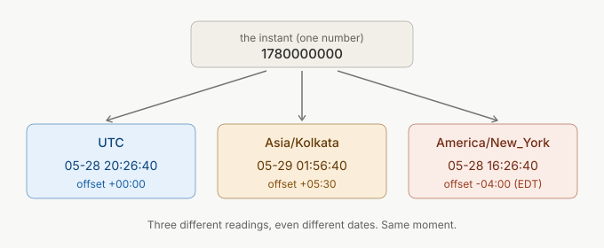
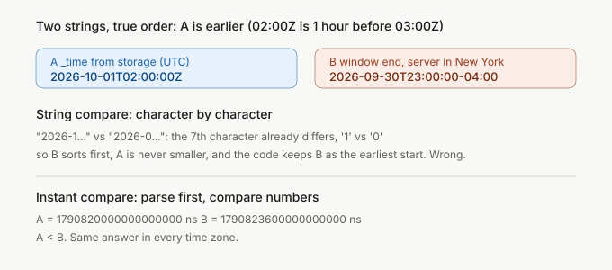

It works on my machine, because my machine is in India.

India is UTC+5:30 all year, with no daylight saving. I run `go test`, everything is green, I push. Then someone on a laptop in Chicago, or a server in New York, runs the same code and gets zero results. The code is the same and so is the data. Only the clock setting differs.


Here is the smallest version of that I could make: a function that finds the earliest of some timestamps, run under two zone settings.

```text
TZ=UTC               buggy correct? true
TZ=America/New_York  buggy correct? false
```

The code comes later. First, what time is to a computer, and why one instant can be written many ways. Then how Go handles it, and a real bug I fixed in VictoriaTraces that only showed up on servers behind UTC. At the end there is a cheat sheet and a command that finds this class of bug in your own tests.

## What time is to a computer

A computer does not store "Thursday, 1 October, 2:00 AM". It stores one number: the count of seconds since 1970-01-01 00:00:00 UTC. That moment is called the Unix epoch, and the number is the Unix timestamp.

```go
fmt.Println(time.Unix(0, 0).UTC())
// 1970-01-01 00:00:00 +0000 UTC

t := time.Unix(1780000000, 0)
fmt.Println(t.Unix(), t.UnixMilli(), t.UnixNano())
// 1780000000 1780000000000 1780000000000000000
```

One instant, three common units. Seconds is 10 digits today, milliseconds is 13, nanoseconds is 19. JavaScript and Java like milliseconds. Go uses nanoseconds internally. Many Linux tools use seconds. When a timestamp lands in 1970, someone fed seconds to something that expects milliseconds:

```go
fmt.Println(time.UnixMilli(1780000000).UTC())
// 1970-01-21 14:26:40 +0000 UTC
```

So a Unix timestamp is a count from a fixed starting point, and it has no time zone. It does not say "morning" or "Tuesday". It only says how far along the line we are.

The same number looks different on different clocks on the wall:



These are the real outputs of `t.In(zone).Format(time.RFC3339)` for `1780000000`:

```text
UTC                2026-05-28T20:26:40Z
Asia/Kolkata       2026-05-29T01:56:40+05:30
America/New_York   2026-05-28T16:26:40-04:00
```

Kolkata is already on the next day. One moment, three readings. Every bug in this post comes from mixing up the moment with one of its readings.

## UTC, offsets and time zones are three different things

People use these words as if they meant the same thing. They don't.

- **UTC** is the reference clock. Everyone agrees on it. It never has daylight saving. You can write it as `Z`, short for "Zulu", the military name for UTC.
- An **offset** is a fixed distance from UTC, like `+05:30` or `-04:00`. It is a snapshot: right now, on this date, this place is 5 hours 30 minutes ahead.
- A **time zone** is a rulebook for one place. `Asia/Kolkata` and `America/New_York` are names from the IANA time zone database (also called tz database or Olson database). Each name holds the history: which offset the place used on which date, and when daylight saving starts and stops.

An offset gives the answer for one moment. A zone name gives it for any moment, including past rule changes. So store the name when you need to compute things later, and an offset when you only describe one instant.

**UTC vs GMT.** GMT is a time zone: the mean solar time at Greenwich, used by the UK in winter. UTC is a time standard kept by atomic clocks. For normal software work they read the same. If you need to pick one for code or config, pick UTC. Do not write GMT for a machine-readable value.

Offsets are not always whole hours. This breaks code written by people who only tested in the US:

| zone | offset in 2026 | note |
|---|---|---|
| `Asia/Kolkata` | +05:30 | no DST |
| `Pacific/Chatham` | +12:45 (winter), +13:45 (summer) | 45 minutes |
| `Australia/Lord_Howe` | +10:30 (winter), +11:00 (summer) | DST step is 30 minutes, not 60 |

I got these from `zdump -v -c 2026,2027` on the tz database: Chatham switches on 2026-04-05 and 2026-09-27, Lord Howe on 2026-04-05 and 2026-10-04. Both zones come back in the experiment.

## Daylight saving time: clocks skip and repeat

In America/New_York, clocks jump forward on 2026-03-08 and back on 2026-11-01. `zdump` shows the exact edges in UTC:

```text
Sun Mar  8 06:59:59 2026 UT = Sun Mar  8 01:59:59 2026 EST
Sun Mar  8 07:00:00 2026 UT = Sun Mar  8 03:00:00 2026 EDT
Sun Nov  1 05:59:59 2026 UT = Sun Nov  1 01:59:59 2026 EDT
Sun Nov  1 06:00:00 2026 UT = Sun Nov  1 01:00:00 2026 EST
```

Read the first pair. One second after 01:59:59 comes 03:00:00. The hour from 02:00 to 03:00 never happens on that day. In November it goes the other way: 01:59:59 EDT is followed by 01:00:00 EST, so everything between 01:00 and 02:00 happens twice.


I ran both cases in Go to see what happens:

```go
ny, _ := time.LoadLocation("America/New_York")

gap := time.Date(2026, 3, 8, 2, 30, 0, 0, ny)  // this time never existed
fmt.Println(gap)                                // 2026-03-08 01:30:00 -0500 EST

fold := time.Date(2026, 11, 1, 1, 30, 0, 0, ny) // this time happened twice
fmt.Println(fold)                               // 2026-11-01 01:30:00 -0400 EDT
fmt.Println(fold.Add(time.Hour))                // 2026-11-01 01:30:00 -0500 EST
```

Go gave me 01:30 EST for a 02:30 that does not exist, and the first of the two 01:30s for the repeated one. The [docs for `time.Date`](https://pkg.go.dev/time#Date) say Go returns a time that is correct in one of the two zones around the transition and does not say which. Don't rely on my output. The answer is unspecified.

A calendar day is also not always 24 hours:

```text
day starting 2026-03-08 is 23h0m0s long
day starting 2026-11-01 is 25h0m0s long
day starting 2026-06-01 is 24h0m0s long
Lord Howe 2026-04-05 length: 24h30m0s
```

And "add one day" has two meanings:

```text
noon 03-07 + 24h      : 2026-03-08 13:00:00 -0400 EDT
noon 03-07 AddDate 1d : 2026-03-08 12:00:00 -0400 EDT
```

`Add(24*time.Hour)` moves the instant forward by 24 real hours, so the wall clock reads 13:00. `AddDate(0, 0, 1)` moves the calendar, so the wall clock reads 12:00. A daily report job wants the second. A "token expires in 24 hours" wants the first. The difference only shows up on two days a year.

## Writing time down: ISO 8601 and RFC 3339

A text format has to say which reading of the moment it uses. Compare:

```text
2026-10-01 02:00              no zone: which moment is this?
2026-10-01T02:00:00Z          UTC
2026-09-30T21:00:00-05:00     the same moment, written with an offset
```

The first has no zone, so it means a different moment on every machine that reads it. The second and third are different texts for one instant:

```go
a, _ := time.Parse(time.RFC3339, "2026-10-01T02:00:00Z")
b, _ := time.Parse(time.RFC3339, "2026-09-30T21:00:00-05:00")
fmt.Println(a.Equal(b)) // true
```

**ISO 8601 vs RFC 3339.** ISO 8601 is the big standard for dates and times. It allows many shapes, including some with no zone and some with only a week number. [RFC 3339](https://datatracker.ietf.org/doc/html/rfc3339) is a stricter profile made for the internet: full date, `T`, full time, and a required `Z` or offset. APIs, JSON and logs should use RFC 3339. In Go that is `time.RFC3339` and `time.RFC3339Nano`, which keeps fractional seconds.

These texts do not sort correctly in general, though. Two strings for the same moment compare unequal. More on that in two sections.

## Store, compare, display: three jobs, three rules

Every time value in your program does one of three jobs:

1. **Store or send** it. Use an instant: a Unix number, or RFC 3339 in UTC (`Z`).
2. **Compare or compute** with it. Use instants. Parse text into a real time value first.
3. **Display** it. Convert to the viewer's zone at the last moment, right before it hits the screen.

Should you store dates in UTC? Yes, for instants: when a log line arrived, when an order was paid. Jon Skeet's post [Storing UTC is not a silver bullet](https://codeblog.jonskeet.uk/2019/03/27/storing-utc-is-not-a-silver-bullet/) covers the exception, which is a future event set in local time. His example is a conference at 9am on 10 July 2022 in Amsterdam, registered in 2019. The UTC value computed then goes wrong if the Netherlands later changes its offset, and a countdown built on it hits zero an hour early. He says to keep the local time and the zone ID as the source data, and treat the UTC instant as something you derive and recompute. He still considers UTC fine for timestamps of things that already happened.

So my dentist at 09:00 on 2027-03-14 in Berlin is stored as that local time plus `Europe/Berlin`. UTC is for things that happened. Local time plus zone name is for things people plan.

## The trap: comparing time as strings

RFC 3339 looks like it sorts, so people compare it with `<`. That works until two strings use different offsets.

```go
a := "2026-10-01T02:00:00Z"
b := "2026-09-30T23:00:00-04:00" // 03:00 UTC, one hour after a

fmt.Println(a < b) // false: the string compare says a comes later
```

`a` is one hour before `b`. The comparison says the opposite, because Go compares bytes from the left, and at the month digit `1` is bigger than `0`. The comparison never reaches the part that says `-04:00`.



The fix is to turn text into instants before comparing. Strings only sort correctly when they all use the same offset (all `Z`, same number of fractional digits), and one caller that formats in local time breaks that.

## The real bug: VictoriaTraces trace search

A user opened [VictoriaTraces issue #260](https://github.com/VictoriaMetrics/VictoriaTraces/issues/260), titled "Jaeger/Tempo API calls returning inconsistent results when compared to the UI". On version 0.11.1, a trace search with `minDuration=100ms` returned very different counts than `minDuration=101ms`. More restriction, more results. That should never happen.


I reproduced it and wrote the fix, [PR #262](https://github.com/VictoriaMetrics/VictoriaTraces/pull/262), merged on 2026-10-01. The reporter's host ran `America/Chicago`. In the issue thread they confirmed that adding `TZ=UTC` to the service fixed it. The same search against the same data gave these counts (limit=1000, copied from the PR description):

| build | server `TZ` | 1h, no filter | 1h, `minDuration=100ms` | 24h, no filter |
|---|---|---|---|---|
| master | `UTC` | 534 | 363 | 1000 |
| master | `America/New_York` | 0 | 0 | 0 |
| PR #262 | `America/New_York` | 534 | 363 | 1000 |

The server's zone setting alone gave zero results. Here is the function before the fix ([`findTraceIDsSplitTimeRange`](https://github.com/VictoriaMetrics/VictoriaTraces/blob/c9df559b0a35d3251d4f1b8e008e0f3f8f431073/app/vtselect/traces/query/query.go#L271)). It finds the earliest start time among the trace spans it just fetched, so that the follow-up query can use the right time range:

```go
maxStartTimeStr := endTime.Format(time.RFC3339)
// ...
if v < maxStartTimeStr {
	maxStartTimeStr = strings.Clone(v)
}
```

<a class="src-link" href="https://github.com/VictoriaMetrics/VictoriaTraces/blob/c9df559b0a35d3251d4f1b8e008e0f3f8f431073/app/vtselect/traces/query/query.go#L281-L305" target="_blank" rel="noopener noreferrer">↗ app/vtselect/traces/query/query.go · findTraceIDsSplitTimeRange</a>

`endTime` is a Go `time.Time` in the server's local zone, so `Format(time.RFC3339)` writes the local wall clock. The values `v` come from the stored `_time` field, which is UTC. So the code compares a local string against UTC strings, the trap from the last section.

PR #262 says that behind UTC this gives the wrong start time. I wanted to see the mechanism with my own eyes, so I copied the logic into a 20-line program and ran it in several zones. The window ends at 03:00 UTC, and two spans started at 02:00 and 02:30 UTC. The right answer is 02:00:

```go
func earliestStart(end time.Time, utcTimes []string) string {
	min := end.Format(time.RFC3339)
	for _, v := range utcTimes {
		if v < min {
			min = v
		}
	}
	return min
}
```

Real output of that program, one run per zone:

```text
--- UTC
bound as the buggy code writes it: 2026-10-01T03:00:00Z
buggy  earliest: 2026-10-01T02:00:00Z
buggy correct?   true
--- Asia/Kolkata
bound as the buggy code writes it: 2026-10-01T08:30:00+05:30
buggy  earliest: 2026-10-01T02:00:00Z
buggy correct?   true
--- America/New_York
bound as the buggy code writes it: 2026-09-30T23:00:00-04:00
buggy  earliest: 2026-09-30T23:00:00-04:00
buggy correct?   false
--- America/Chicago
bound as the buggy code writes it: 2026-09-30T22:00:00-05:00
buggy  earliest: 2026-09-30T22:00:00-05:00
buggy correct?   false
```

(I also ran Chatham and Lord Howe, both ahead of UTC. Both gave `true`.)

Behind UTC, the local wall clock reads *earlier* than the UTC clock, so the local bound string sorts before every real timestamp. Nothing replaces it, and the function returns "the earliest start is 23:00 yesterday", wrong by hours. The span query that follows looks in the wrong window and finds nothing. Ahead of UTC, the local string reads later than the UTC ones, so the buggy comparison works by luck. That is probably how it survived: many developers sit in UTC or ahead of it.

My toy program only shows that the string comparison goes wrong behind UTC, in the same shape as the PR code. I did not run the full server in every zone. The PR table is the server-level evidence.

### The fix is small

Parse each `_time` into nanoseconds with VictoriaLogs' `TryParseTimestampRFC3339Nano`, and compare integers. Keep the bound as `endTime.UnixNano()`. Return `time.Unix(0, ns)` at the end:

```go
maxStartTimeNs := endTime.UnixNano()
// ...
if ns, ok := logstorage.TryParseTimestampRFC3339Nano(v); ok && ns < maxStartTimeNs {
	maxStartTimeNs = ns
}
// ...
return checkTraceIDList(traceIDList), time.Unix(0, maxStartTimeNs), nil
```

<a class="src-link" href="https://github.com/VictoriaMetrics/VictoriaTraces/blob/d1682f028bcdd6a27c3342170088fb062c68aba3/app/vtselect/traces/query/query.go#L281-L345" target="_blank" rel="noopener noreferrer">↗ app/vtselect/traces/query/query.go · findTraceIDsSplitTimeRange</a>

The Tempo API has a copy of the same function, so I changed both. The diff is six added and fifteen removed lines per file: the two `time.Parse` calls that turned the string back into a time are gone, because there is no string anymore. I also changed one `time.Parse(time.RFC3339, ...)` to `RFC3339Nano` in a third place that parses a stored timestamp, since those can carry fractional seconds.

### Why every test passed

The old tests ran on whatever zone the machine had. In UTC the buggy code is correct, and Go falls back to UTC when there is no `TZ` and no `/etc/localtime`, as in a minimal container. I have not checked which zone VictoriaTraces CI uses. The bug shipped and a user found it.

More data would not have caught it. The test needed a zone. [`TestSingleSearchTracesNonUTCTimezone`](https://github.com/VictoriaMetrics/VictoriaTraces/blob/d1682f028bcdd6a27c3342170088fb062c68aba3/apptest/tests/search_timezone_test.go) starts `vtsingle` with the environment variable `TZ=America/New_York`, sends one span, and asks both the Jaeger API and the Tempo API for it. To make that possible, the test harness in `apptest` now passes environment variables to the process it starts.

## Go's time package: the parts that bite

Most of this is in the [`time` docs](https://pkg.go.dev/time). These are the parts I keep seeing in bugs:

**A `time.Time` is an instant plus a `*Location`.** The location only changes how it prints. Two values for one moment can be `Equal` but not `==`:

```go
fmt.Println(a == a.In(kolkata), a.Equal(a.In(kolkata))) // false true
```

Use `Equal`, `Before` and `After`. Do not use `==` or use a `Time` as a map key unless you know both come from the same location.

**`Local` comes from `TZ`.** On Unix, `time.Local` reads the `TZ` environment variable. No `TZ` means `/etc/localtime`. `TZ=""` means UTC. `TZ="foo"` means "the file foo in the system zone directory". Mine is `/etc/localtime -> Asia/Kolkata`, hence the joke at the top. A typo is silent. I ran this:

```text
TZ=Asia/Kolkatta  ->  UTC 2026-01-01 00:00:00 +0000 UTC
TZ=Asia/Kolkata   ->  Asia/Kolkata 2026-01-01 00:00:00 +0530 IST
```

A wrong zone name does not fail. It becomes UTC. Print `time.Local` once in test setup if you rely on it.

**`Parse` assumes UTC when the text has no zone.** `time.Parse("2006-01-02 15:04", "2026-10-01 02:00")` gives 02:00 UTC on every machine. If the text means local time, use `time.ParseInLocation(layout, text, loc)` with an explicit location. One more surprise from the docs: when the text has an offset like `+05:30` and that offset matches the current `Local` zone, `Parse` reuses `Local` as the location. On my laptop the parsed value reported its location as `Local`. With `TZ=UTC` it did not. The instant is the same, but the printed location differs per machine, so never compare locations.

**`Format` uses the value's own location.** `t.Format(time.RFC3339)` on a local `Time` writes local time. That is exactly line one of the VictoriaTraces bug. Call `t.UTC()` first when you want `Z`.

**`LoadLocation` needs a tz database.** It looks in the system directory first, then `$GOROOT/lib/time/zoneinfo.zip`, then an embedded copy if you imported `time/tzdata`. A `scratch` or `distroless` container has no system database. `import _ "time/tzdata"` in `main` adds about 450 KB and makes `LoadLocation("Asia/Kolkata")` work everywhere.

**Use the right unit.** `Unix()` is seconds, `UnixMilli()` is milliseconds, `UnixNano()` is nanoseconds. Name variables `startMs` or `startNs`, so a unit mistake is visible in the code.

## My experiment: five zones, one program

I wanted to see which kinds of tests break in which zones. I wrote a program with six checks, each a typical assumption, and ran it under five `TZ` values on Go 1.25.4 on my Mac, using the tz database that ships with macOS:

```go
// 1. string compare of a local-form string against a UTC-form string
end := time.Date(2026, 10, 1, 3, 0, 0, 0, time.UTC)
local := end.In(time.Local).Format(time.RFC3339)
utc := "2026-10-01T02:00:00Z" // one hour BEFORE end
ok1 := utc < local

// 2. Parse assumes UTC, ParseInLocation uses the zone you give
a, _ := time.Parse("2006-01-02 15:04", "2026-10-01 02:00")
b, _ := time.ParseInLocation("2006-01-02 15:04", "2026-10-01 02:00", time.Local)
ok2 := a.Unix() == b.Unix()

// 3. local midnight vs a hard-coded UTC constant
ok3 := time.Date(2026, 1, 1, 0, 0, 0, 0, time.Local).Unix() == 1767225600

// 4. Truncate(24h) lands on local midnight?
t := time.Date(2026, 10, 1, 15, 0, 0, 0, time.Local)
mid := time.Date(2026, 10, 1, 0, 0, 0, 0, time.Local)
ok4 := t.Truncate(24 * time.Hour).Equal(mid)

// 5. date part of a UTC midnight instant
u := time.Date(2026, 10, 1, 0, 0, 0, 0, time.UTC)
ok5 := u.In(time.Local).Format("2006-01-02") == "2026-10-01"

// 7. whole-hour offsets
_, off := time.Date(2026, 10, 1, 12, 0, 0, 0, time.Local).Zone()
ok7 := off%3600 == 0
```

(The numbering skips 6: that was the DST check, which I ran separately with explicit `LoadLocation`, as shown earlier. DST needs one fixed zone, so it does not belong in a `TZ` matrix.)

Command:

```bash
for z in UTC Asia/Kolkata America/New_York Pacific/Chatham Australia/Lord_Howe; do
  TZ=$z go run ./matrix
done
```

I expected UTC to pass everything and each other zone to break a different subset, and it did. The table comes from the program output:

| check | UTC | Kolkata | New York | Chatham | Lord Howe |
|---|---|---|---|---|---|
| 1 string compare of mixed offsets | pass | pass | **FAIL** | pass | pass |
| 2 `Parse` equals `ParseInLocation(Local)` | pass | **FAIL** | **FAIL** | **FAIL** | **FAIL** |
| 3 local midnight equals UTC constant | pass | **FAIL** | **FAIL** | **FAIL** | **FAIL** |
| 4 `Truncate(24h)` is local midnight | pass | **FAIL** | **FAIL** | **FAIL** | **FAIL** |
| 5 date of UTC midnight stays the same | pass | pass | **FAIL** | pass | pass |
| 7 offset is whole hours | pass | **FAIL** | pass | **FAIL** | **FAIL** |

UTC is the only column with no failures. A suite that runs only in UTC cannot fail these checks.


Four things stood out:

- Check 1, the VictoriaTraces bug, passes in Kolkata, Chatham and Lord Howe. It fails only behind UTC. One zone in India is enough to hide it.
- Check 5 is the mirror: it fails only behind UTC, because UTC midnight is still the day before in New York. Reports that group by `Format("2006-01-02")` shift events to the previous day for those users.
- Check 4: `Truncate(24 * time.Hour)` rounds in absolute time since the zero time, which is UTC-aligned. It does not give local midnight in any zone except UTC. It is a very common "start of day" shortcut.
- Check 7 caught three of the four non-UTC zones. Kolkata, Chatham (+13:45 in October) and Lord Howe (+10:30 in October) all have minutes in the offset, so code that does `offset / 3600` loses them.

## How to test for this

The experiment already contains the method: run the same tests under different `TZ` values.

```bash
for z in UTC Asia/Kolkata America/New_York Pacific/Chatham Australia/Lord_Howe; do
  TZ=$z go test -count=1 ./... || echo "FAIL under $z"
done
```

I wrote one test, check 3, as a real `go test` and ran it:

```text
--- TZ=UTC
ok  	tzlab/tst	0.553s
--- TZ=America/New_York
--- FAIL: TestNewYearUnix (0.00s)
    jan_test.go:11: got 1767243600, want 1767225600
FAIL
```

Tips from this post and from fixing #260:

1. **Run the suite in at least three zones.** One behind UTC (`America/New_York`), one ahead (`Asia/Kolkata`), and one odd (`Pacific/Chatham`). Make the zones a CI matrix, so no one has to remember.
2. **Fail CI if every run shares one zone.** Print `time.Local` in test setup, so a log shows what ran.
3. **Test the DST days.** Use `2026-03-08` and `2026-11-01` in `America/New_York`, or the Lord Howe change for a 30-minute case. Assert the day length and what `Add(24*time.Hour)` and `AddDate(0, 0, 1)` do.
4. **Inject the clock.** A function that calls `time.Now()` inside cannot be tested at a DST edge. Pass the time in, or pass a `func() time.Time`.
5. **Set `TZ` on the process you test**, not only in the test runner, when the code runs in a server. That is what PR #262 did: the harness starts the server with `TZ=America/New_York`.

## Where it still goes wrong

Even with UTC for instants and tests in five zones, three things stay hard.

**Future human events.** Covered above: store local time plus zone name, because governments change the rules. The IANA database ships updates several times a year for that reason, and a long-running server with an old copy computes old offsets.

**Leap seconds.** Unix time pretends they do not exist: every day has exactly 86400 seconds. For almost every application that is what you want. Say so in a design note if you do something where it matters.

**Floating dates.** A birthday is not an instant. "1990-03-14" stays 1990-03-14 for the person born that day, wherever they travel. Storing it as midnight UTC and converting it for display moves it by a day for half the world, which is exactly check 5. Store a plain date.

Noah Sussman's 2012 post "Falsehoods programmers believe about time" is a long list of wrong beliefs about time. It has no fixes, but it is worth reading once.

## Cheat sheet

**Words**
- Instant = Unix number or UTC time. Wall time = what a clock on the wall reads. Zone = an IANA name like `Asia/Kolkata`, not `+05:30`.
- UTC for machines. GMT is a time zone, not a standard to write in config.
- Unix seconds ~10 digits, milliseconds ~13, nanoseconds ~19. A date in 1970 means a unit mix-up.

**Rules**
- Store and compare instants. Convert to the viewer's zone last.
- Future human events: local time plus the IANA zone name.
- Never compare time strings. Parse, then use `Equal`, `Before`, `After`.
- APIs speak RFC 3339 with `Z` or an offset. Reject strings with no zone.
- Day arithmetic: `Add(24*time.Hour)` is 24 real hours, `AddDate(0, 0, 1)` is the same wall clock tomorrow.

**Go**
- `t.UTC()` before `Format` when you want `Z`.
- `Parse` with no zone means UTC. `ParseInLocation` for local text.
- `time.Local` comes from `TZ`, and a typo silently becomes UTC.
- `time.Date` at a DST gap or fold is not defined, so do not rely on which side you get.
- Minimal container? `import _ "time/tzdata"`.
- `Truncate(24*time.Hour)` is not local midnight.

**Tests**
- `TZ=America/New_York go test ./...`, then Chatham, Lord Howe and Kolkata.
- Add the DST dates: 2026-03-08 and 2026-11-01 in New York.
- Print `time.Local` in test setup. Fail CI if every run used one zone.
- Pass the clock in. Do not call `time.Now()` deep inside logic.
